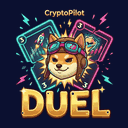

<h1 align="center">Artur Edwardson</h1>

  I build products end to end — trading tools, Telegram bots, AI apps, games. 
  Web · iOS · Android · Telegram · Chrome extensions

  <a href="https://devpilot.studio"><b>Need an app or a website? → DevPilot Studio</b></a>

---

<table>
<tr>
<td width="72" align="center"></td>
<td><a href="https://cryptopilot.se"><b>CryptoPilot</b></a> Crypto analytics brand: whale screener in Telegram, market signals, guides in 10 languages.</td>
</tr>
<tr>
<td align="center"></td>
<td><a href="https://game.cryptopilot.se/?utm_source=github&utm_medium=profile"><b>CryptoPilot Duel</b></a> 1v1 card duel — portfolio vs portfolio. Play in the browser or in Telegram; iOS &amp; Android coming.</td>
</tr>
<tr>
<td align="center"></td>
<td><b>CryptoPilot · Max History</b> Chrome extension for TradingView: your exchanges on top of symbol search and the pair with the longest live chart history. Coming to the Chrome Web Store.</td>
</tr>
<tr>
<td align="center"></td>
<td><a href="https://getdocpilot.app"><b>DocPilot</b></a> AI assistant that explains official letters and documents in your language. Web · Android, iOS coming.</td>
</tr>
<tr>
<td align="center"></td>
<td><a href="https://t.me/whale_screener_hl_bot"><b>Whale Screener bot</b></a> Telegram bot tracking large Hyperliquid positions in real time.</td>
</tr>
<tr>
<td align="center"></td>
<td><a href="https://github.com/Tomteilors/interfold-nodewatch"><b>interfold-nodewatch</b></a> Open-source CLI for Interfold ciphernode operators: status, watch &amp; alerts, Prometheus exporter, E3 inspector.</td>
</tr>
<tr>
<td align="center"></td>
<td><a href="https://devpilot.studio"><b>DevPilot Studio</b></a> We build mobile apps, websites, games, Telegram bots and AI automations — from idea to App Store and Google Play.</td>
</tr>
</table>

---

  <a href="https://devpilot.studio">devpilot.studio</a> ·
  <a href="https://cryptopilot.se">cryptopilot.se</a> ·
  <a href="mailto:hello@cryptopilot.se">hello@cryptopilot.se</a>

